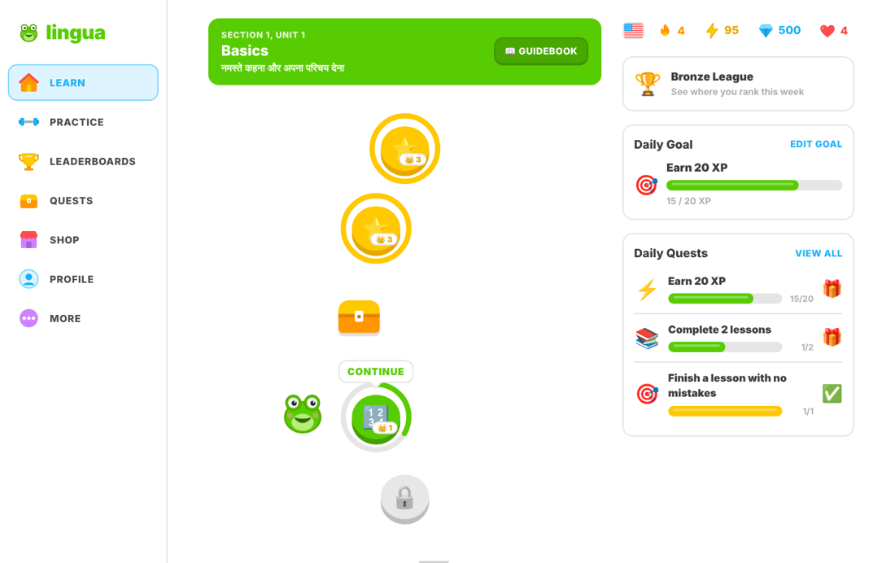
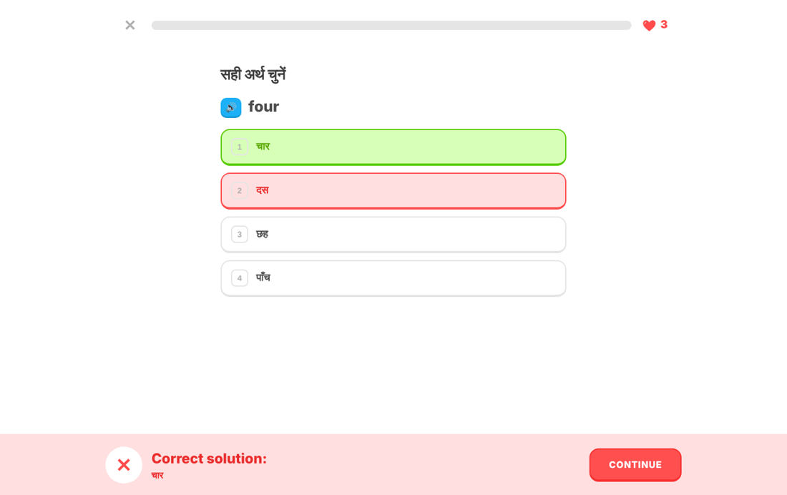
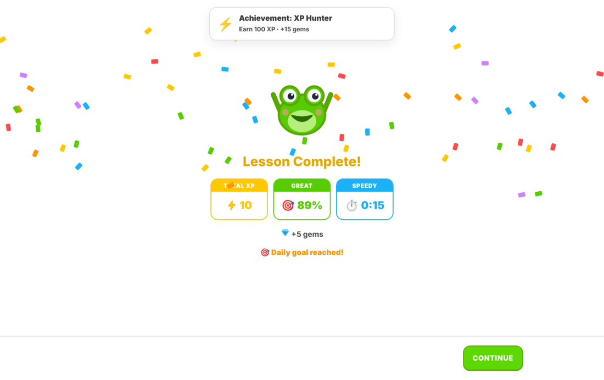
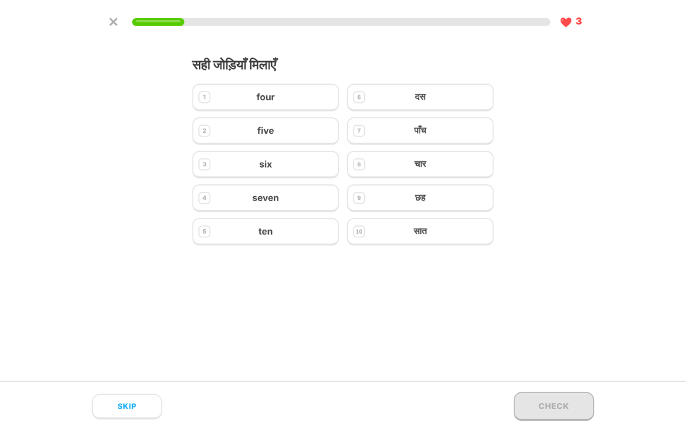
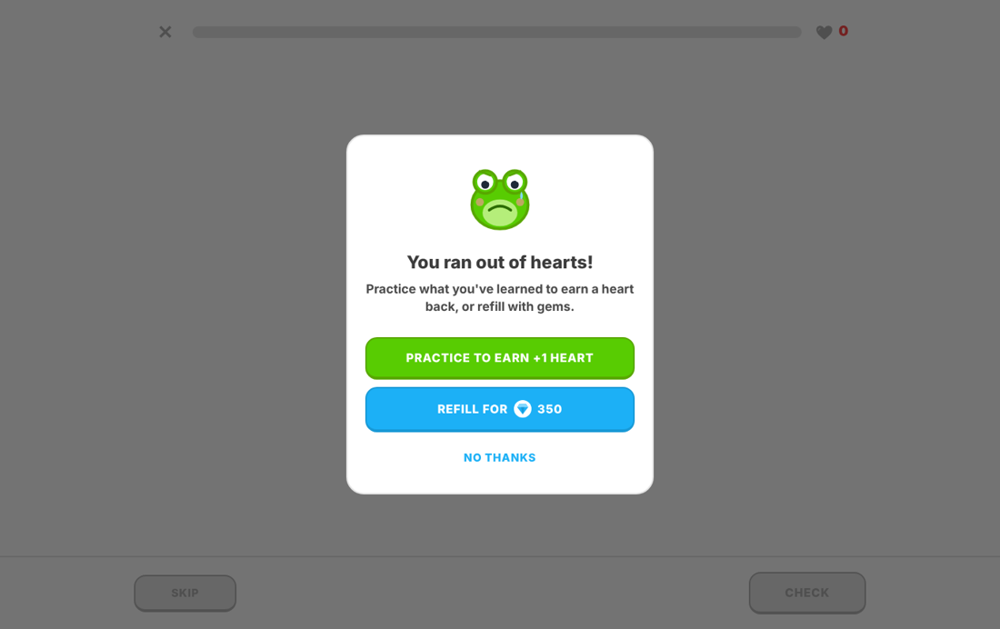
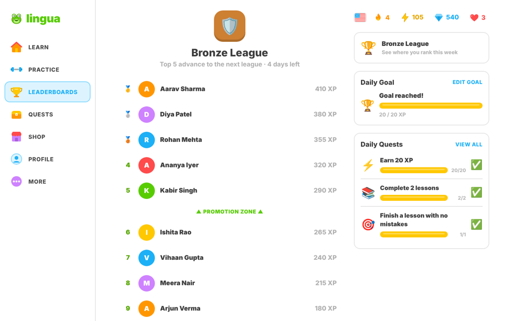
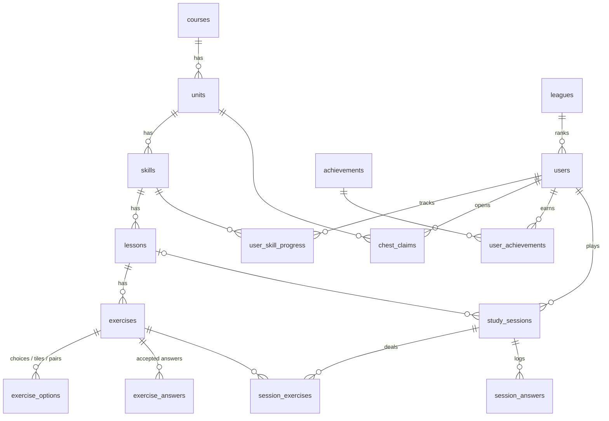

# lingua: a Duolingo-style web app (English for Hindi speakers)

A full-stack clone of Duolingo's lesson loop and gamification: a learning path with locked, available and completed skills, a lesson player with 5 exercise types, XP, streaks, hearts, a daily goal, quests, leaderboards, achievements, a mock shop and practice modes. The seeded course teaches **English to Hindi speakers**: instructions and prompts are in Hindi, answers are in English, as in Duolingo's real course.

Live demo: https://duolingo-clone-raman-f16f.vercel.app/ · API docs: duolingo-clone-api-production.up.railway.app/

| Learning path | Lesson feedback | Lesson complete |
|---|---|---|
|  |  |  |
|  |  |  |

> The mascot ("Kero" the frog), all icons and all code are original work. No Duolingo assets or third-party repositories were used.

## Tech stack

| Layer    | Choice |
|----------|--------|
| Frontend | Next.js 14 (App Router) + TypeScript, plain CSS with design tokens (no UI library) |
| Backend  | Python 3.13, FastAPI, SQLAlchemy 2, Pydantic 2, Alembic migrations |
| Database | SQLite (one file; schema created by migrations, sample data seeded on first start) |
| Tooling  | pytest (30 API tests), ESLint (`next/core-web-vitals`), `tsc` type-check |

## Run it locally

**Backend**: http://localhost:8000 (interactive API docs at `/docs`)
```bash
cd backend
python -m venv .venv && source .venv/bin/activate        # Windows: .venv\Scripts\activate
pip install -r requirements-dev.txt
uvicorn app.main:app --reload --port 8000
```
**Frontend**: http://localhost:3000
```bash
cd frontend
cp .env.example .env.local          # NEXT_PUBLIC_API_URL=http://localhost:8000/api
npm install
npm run dev                         # production: npm run build && npm start
```
**Checks**
```bash
cd backend  && pytest               # 30 tests: lesson loop, integrity rules, hearts, streak, modes, leaderboard
cd frontend && npm run lint && npm run typecheck
```

On first start the backend runs `alembic upgrade head` and seeds the course plus a sample learner. The learner already has two finished skills, a 4-day streak, 4 hearts and 95 XP, so the app is usable straight away. To start over, delete `backend/duolingo.db`, or use **More → Testing tools → Restore demo learner**.

Deployment (Railway + Vercel, with persistent SQLite): see **[DEPLOY.md](DEPLOY.md)**.

## Features

**Core**
* **Learning path:** 3 units × 4 skills. Each skill node shows locked, available or completed state, a progress ring, a crown count and the bouncing START/CONTINUE bubble. Each unit also has a treasure chest (+20 gems, opens once) and a unit trophy (unlocks a unit review). Skills unlock in order.
* **Lesson player:** 5 exercise types: multiple choice, translate (word bank), match pairs, fill in the blank and type the answer. It has a progress bar, the green/red feedback bar with "Correct solution", "5 in a row!" combo messages, typo tolerance ("You have a typo."), sound effects, text-to-speech and keyboard control (Enter, number keys). Wrong answers cost a heart and come back at the end of the lesson.
* **Hearts:** maximum 5, regenerating 1 every 30 minutes (computed lazily, no background job). Refill with gems in the Shop or the hearts popover, or **practice to earn +1**. At 0 hearts the out-of-hearts modal blocks lessons, and the server enforces this too.
* **XP and streak:** 10 XP per lesson (+5 if perfect). The streak increases on the first activity of the learner's day (in their own time zone) and resets after a missed day. **More → Simulate next day** makes the day logic testable.
* **Daily goal and quests:** a configurable goal (10/20/30/50 XP) and three daily quests computed from today's activity.
* **Leaderboard:** a real weekly XP ranking of everyone in your league (seeded rivals plus you), with promotion and demotion zones.
* **Profile:** streak, total XP, accuracy, skills, lessons, gems, and 10 achievements with progress bars.
* **Persistence:** all progress (XP, streak, hearts, skills, chests, badges, sessions) is stored per user in SQLite.

**Bonus:** achievements/badges · audio (browser TTS + Web Audio effects) · a real leaderboard across seeded users · timed practice (2 minutes) · legendary challenge (at most 1 mistake, awards a crown) · dark mode · responsive layout (the sidebar becomes a bottom tab bar on phones).

**Placeholders ("Coming soon"):** speaking exercises, Super subscription, streak freeze, friends and social features, changing course, guidebook, notifications.

## Architecture

```
frontend/src
  app/            routes: (main)/learn|practice|leaderboard|quests|shop|profile|settings  (shared shell)
                          lesson/[id], session/[kind]                                       (full-screen player)
  components/     LessonPlayer (state machine for every mode) · exercises (5 types) · PathNode (skill/chest/trophy)
                  LessonEnd (result, streak, modals) · Chrome (sidebar, stats bar, right rail) · ui · Icons · Mascot
  lib/            api.ts (typed client) · types.ts (mirrors backend schemas) · user-context.tsx · sound.ts

backend/app
  main.py         FastAPI app: CORS, GameError -> HTTP error mapping, migrations + seed on startup
  routers/        thin HTTP layer: learner, path, sessions, social, dev   (validate -> call service -> commit)
  services/       game rules, no HTTP: sessions, hearts, clock (time zone, streak), answers, path,
                  achievements, social, users, rules (all tunable constants)
  schemas.py      Pydantic request/response models (also generate the OpenAPI docs)
  models.py       SQLAlchemy schema          migrate.py / migrations/   Alembic
  content.py      course data                seed.py                    content generator + demo data
```

**Key decisions**
* **The server is the source of truth.** A lesson is a server-side *study session*. The server deals the exercises, checks each answer against the session (only that session's exercises, one try in timed/legendary modes, hearts required in lessons), counts mistakes, and awards XP only once every exercise is solved. The client cannot report its own score.
* **No answers in the payload.** Exercises are sent without answers. In match pairs, the right-hand tiles carry opaque HMAC tokens, so the pairs can't be read from the response.
* **Derived, not duplicated.** Daily XP, the daily goal, quests, the weekly leaderboard and the streak calendar are all computed from completed `study_sessions`. Only fast-changing counters (total XP, gems, hearts, streak) live on `users`.
* **Lazy time-based rules.** Heart regeneration and streak expiry are applied whenever the learner is read, so no cron jobs are needed. "Today" is computed in the learner's IANA time zone, which the browser reports.
* **Services raise `GameError(status, code, message)`.** One exception handler turns it into `{"detail", "code"}`, and the client reacts to codes such as `out_of_hearts` or `time_up`.
* **Content generated from compact data.** `content.py` lists vocabulary and sentences per skill. `seed.py` expands them into 3 lessons × 8 varied exercises per skill (288 exercises).

## Database schema



| Table | Purpose / notable columns |
|-------|---------------------------|
| `courses`, `units`, `skills`, `lessons` | Content tree. `position` orders siblings (unique per parent); units have a banner `color`, skills an emoji `icon` |
| `exercises` | `type` (CHECK: 5 types), `prompt`, `source_text`, `hint` |
| `exercise_answers` | Accepted answers, one `is_primary` (shown as the correct solution) plus alternatives such as "He/She is…" |
| `exercise_options` | Choices, word-bank tiles, or match pairs (`text` + `pair_text`) |
| `leagues` | Bronze → Diamond (`tier`, `name`, `color`) |
| `users` | `total_xp`, `gems`, `hearts` (CHECK 0–5) + `hearts_updated_at`, `streak`, `longest_streak`, `last_active_date`, `daily_goal_xp`, `timezone`, `day_offset` (simulated days), `league_id` |
| `user_skill_progress` | Lessons completed per skill + legendary flag (unique user+skill) |
| `chest_claims` | Path chests opened (unique user+unit) |
| `achievements`, `user_achievements` | Badge definitions (`metric` + `threshold` + `gem_reward`) and unlocks |
| `study_sessions` | One run of the player: `kind` (lesson/practice/timed/legendary), `status` (active/completed/failed/abandoned), `mistakes`, `correct_count`, `xp_earned`, `time_limit_sec`, `max_mistakes`, `activity_date` (learner-local) |
| `session_exercises` | The exercises dealt into a session and whether each has been answered or solved |
| `session_answers` | Every submitted answer (audit log; also records matched pairs) |

Foreign keys are enforced (`PRAGMA foreign_keys=ON`) and every FK column is indexed. Content cascades on delete, and constraint names follow a naming convention so that migrations stay deterministic (`migrations/versions/0001_initial_schema.py`).

## API overview (all under `/api`; full schemas at `/docs`)

| Method & path | Description |
|---|---|
| `GET /me` · `PATCH /me` | Learner snapshot (XP, gems, hearts + regen timer, streak, daily goal, week, league) · update goal / name / time zone |
| `POST /hearts/refill` | Spend gems to refill hearts |
| `GET /path` | Units → nodes (skills, chest, trophy) with state, progress and next lesson |
| `POST /units/{id}/chest` | Open a unit's treasure chest |
| `POST /sessions` | Start `{kind, lesson_id \| skill_id \| unit_id}` → exercises without answers (403 `locked` / `out_of_hearts`) |
| `POST /sessions/{id}/answers` | `{exercise_id, answer}` → `{correct, typo, correct_answer, hearts, mistakes, status, …}` |
| `POST /sessions/{id}/pairs` | `{exercise_id, left_id, right_id}` → check one match-pairs pair |
| `POST /sessions/{id}/complete` | Award XP, gems, progress, streak and badges (409 if unfinished or failed) |
| `POST /sessions/{id}/abandon` | Quit |
| `GET /leaderboard` · `GET /profile` · `GET /quests` | Weekly league ranking · stats + badges · today's quests |
| `POST /dev/advance-day` · `POST /dev/reset` | Testing aids (simulate days; restore demo / start empty). Disabled with `ENABLE_DEV_TOOLS=false` |

Errors look like `{"detail": "You're out of hearts…", "code": "out_of_hearts"}`.

## Assumptions and simplifications
* **Authentication** is simplified, as the brief allows: every request acts as the default learner (id 1). An `X-User-Id` header exists only so tests can act as seeded rivals.
* **One course** (English for Hindi speakers). Audio uses the browser's text-to-speech; sound effects use the Web Audio API.
* **Gems** are a mock currency: 500 to start, +5 per lesson, chest and badge rewards, and a heart refill costs 350.
* Mismatched pairs in match-pairs count as mistakes but do not cost hearts.
* Typo tolerance (one letter off) applies only to typed answers of 4+ letters.
* The leaderboard league is seeded (everyone in Bronze); promotion between leagues is not simulated.
* The testing tools are on by default so reviewers can test streak logic. Turn them off in production with `ENABLE_DEV_TOOLS=false`.
